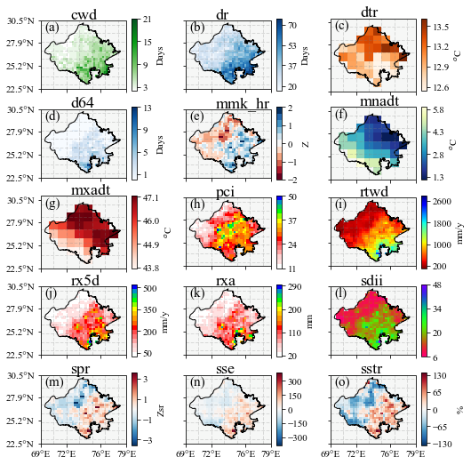

> [!NOTE]
> Updated September 2026: the current IMDLIB release is 0.1.22. The functions used below (`open_data`, `fill_na`, `clip`, `compute` and `get_xarray`) work the same way in it.

## Description

IMDLIB is a handy resource designed to assist researchers, meteorologists, and weather enthusiasts in analyzing and understanding climate data for India. In the latest version of IMDLIB (0.1.17), we have added computation of few popular climate indices in the IMDLIB package. This blog will showcase the seamless utilization of these pivotal climate indices in a programmatic fashion for the Godavari River Basin, providing a practical and efficient approach to their implementation.

## Load libraries

```python
%matplotlib inline
import imdlib as imd
import numpy as np
import string
```

## Get Data

```python
# load data
start_yr, end_yr = 2015, 2019

variable = 'rain'
rain = imd.open_data(variable, start_yr, end_yr,'yearwise', '../data')
# Fill Missing Data
rain.fill_na()
# Clip data for the Godavari River Basin (using Shapefile)
rain.clip('../gis/god.shp')

variable = 'tmax'
tmax = imd.open_data(variable, start_yr, end_yr,'yearwise', '../data')
# Fill Missing Data
tmax.fill_na()
# Clip data for the Godavari River Basin (using Shapefile)
tmax.clip('../gis/god.shp')

variable = 'tmin'
tmin = imd.open_data(variable, start_yr, end_yr,'yearwise', '../data')
# Fill Missing Data
tmin.fill_na()
# Clip data for the Godavari River Basin (using Shapefile)
tmin.clip('../gis/god.shp')
```

## Computation of climate indices

### Consecutive wet days

```python
cwd = rain.copy()
cwd.compute('cwd', 'A')
```

### Rainy days

```python
dr = rain.copy()
dr.compute('dr', 'A')
```

### Diurnal Temperature Range

```python
dtr_tmax = tmax.copy()
dtr_tmin = tmin.copy()
dtr_tmax.compute('dtr', 'A', tmin=dtr_tmin)
```

### Heavy precipitation days

```python
d64 = rain.copy()
d64.compute('d64', 'A')
```

### Modified Mann-Kendall test statistic

```python
mmk_hr = rain.copy()
mmk_hr.compute('mmk_hr', 'A')
```

### Coolest night

```python
mnadt = tmin.copy()
mnadt.compute('mnadt', 'A')
```

### Hottest day

```python
mxadt = tmax.copy()
mxadt.compute('mxadt', 'A')
```

### Precipitation concentration index

```python
pci = rain.copy()
pci.compute('pci', 'A')
```

### Total precipitation in wet days

```python
rtwd = rain.copy()
rtwd.compute('rtwd', 'A')
```

### Maximum 5-days rainfall

```python
rx5d = rain.copy()
rx5d.compute('rx5d', 'A')
```

### Maximum daily rainfall

```python
rxa = rain.copy()
rxa.compute('rxa', 'A')
```

### Simple daily intensity index

```python
sdii = rain.copy()
sdii.compute('sdii', 'A')
```

### Spearman’s Rho statistics

```python
spr = rain.copy()
spr.compute('spr', 'A')
```

### Sen’s slope estimate

```python
sse = rain.copy()
sse.compute('sse', 'A')
```

### Magnitude of trend

```python
sstr = rain.copy()
sstr.compute('sstr', 'A')
```

## Convert IMDLIB data into xarray data

```python
# IMD to Netcdf and prepare for plot

cwd = cwd.get_xarray()
cwd = cwd.isel(time=-1)
cwd = cwd.cwd

dr = dr.get_xarray()
dr = dr.isel(time=-1)
dr = dr.dr

dtr_tmax = dtr_tmax.get_xarray()
dtr_tmax = dtr_tmax.isel(time=-1)
dtr_tmax = dtr_tmax.dtr

d64 = d64.get_xarray()
d64 = d64.isel(time=-1)
d64 = d64.d64

mmk_hr = mmk_hr.get_xarray()
mmk_hr = mmk_hr.isel(time=-1)
mmk_hr = mmk_hr.mmk_hr

mnadt = mnadt.get_xarray()
mnadt = mnadt.isel(time=-1)
mnadt = mnadt.mnadt

mxadt = mxadt.get_xarray()
mxadt = mxadt.isel(time=-1)
mxadt = mxadt.mxadt

pci = pci.get_xarray()
pci = pci.isel(time=-1)
pci = pci.pci

rtwd = rtwd.get_xarray()
rtwd = rtwd.isel(time=-1)
rtwd = rtwd.rtwd

rx5d = rx5d.get_xarray()
rx5d = rx5d.isel(time=-1)
rx5d = rx5d.rx5d

rxa = rxa.get_xarray()
rxa = rxa.isel(time=-1)
rxa = rxa.rxa

sdii = sdii.get_xarray()
sdii = sdii.isel(time=-1)
sdii = sdii.sdii

spr = spr.get_xarray()
spr = spr.isel(time=-1)
spr = spr.spr

sse = sse.get_xarray()
sse = sse.isel(time=-1)
sse = sse.sse

sstr = sstr.get_xarray()
sstr = sstr.isel(time=-1)
sstr = sstr.sstr
```

## Plotting Data

```python
import cartopy.crs as ccrs
import cartopy
from cartopy.feature import ShapelyFeature
from cartopy.io.shapereader import Reader
from cartopy.mpl.ticker import LongitudeFormatter, LatitudeFormatter
import cmaps
import matplotlib.colors as colors
import matplotlib.image as mpimg
from matplotlib.ticker import MultipleLocator
import matplotlib.pyplot as plt
from mpl_toolkits.axes_grid1 import make_axes_locatable
import matplotlib as mpl

class MidpointNormalize(colors.Normalize):
    def __init__(self, vmin=None, vmax=None, midpoint=None, clip=False):
        self.midpoint = midpoint
        colors.Normalize.__init__(self, vmin, vmax, clip)

    def __call__(self, value, clip=None):
        # I'm ignoring masked values and all kinds of edge cases to make a
        # simple example...
        x, y = [self.vmin, self.midpoint, self.vmax], [0, 0.5, 1]
        return np.ma.masked_array(np.interp(value, x, y), np.isnan(value))

proj = ccrs.PlateCarree()
lon_formatter = LongitudeFormatter(zero_direction_label=True)
# lon_formatter = LongitudeFormatter()
lat_formatter = LatitudeFormatter()

# Shapefile Read
sp_nm = '../gis/god.shp'
shape_feature = ShapelyFeature(Reader(sp_nm).geometries(), proj, edgecolor='black')

# # Get bounding box
# import geopandas as gpd
# tmp = gpd.read_file(sp_nm)
# print(tmp.total_bounds) # print lower left (lon, lat) and upper right (lon, lat)
# # 73.47881334, 16.53814697, 83.15886298, 22.69166667

fig, ax = plt.subplots(5, 3, figsize=(8, 11), subplot_kw={'projection':proj})
fig.subplots_adjust(left=None, bottom=None, right=None, top=None, wspace=0.25, hspace=-0.5)

plt.rcParams['axes.xmargin'] = 0
plt.rcParams['font.size'] = 11
plt.rcParams["font.family"] = "Times New Roman"
plt.rcParams["font.weight"] = "normal"
fs = 10
plt_lab = string.ascii_lowercase[:15]
plt_tit = ['cwd', 'dr', 'dtr', 'd64', 'mmk_hr', 'mnadt', 'mxadt', 'pci', 'rtwd', 'rx5d', 'rxa', 'sdii', 'spr', 'sse', 'sstr']

f1_1 = cwd.plot(ax=ax[0, 0], transform=proj, cmap = cmaps.WhiteGreen,
               cbar_kwargs={'ticks': [5, 10, 15, 20, 25],
                            "shrink":0.34, "aspect":10, 'label':'Days'})
f1_2 = dr.plot(ax=ax[0, 1], transform=proj, cmap = cmaps.MPL_Blues,
              cbar_kwargs={'ticks': [38, 68, 98, 128],
                            "shrink":0.34, "aspect":10, 'label':'Days'})
f1_3 = dtr_tmax.plot(ax=ax[0, 2], transform=proj, cmap = cmaps.MPL_Oranges,
                    cbar_kwargs={'ticks': [9.8, 11.1, 12.4, 13.7],
                            "shrink":0.34, "aspect":10, 'label':'$^o$C'})
f1_4 = d64.plot(ax=ax[1, 0], transform=proj, cmap = 'Blues',
               cbar_kwargs={'ticks': [0, 6, 12, 18],
                            "shrink":0.34, "aspect":10, 'label':'Days'})

vmin_f1_4 = -2
vmax_f1_4 = 2
norm_f1_4 = colors.TwoSlopeNorm(vmin=vmin_f1_4, vcenter=0, vmax=vmax_f1_4)
f1_5 = mmk_hr.plot(ax=ax[1, 1], transform=proj, cmap = cmaps.CBR_coldhot_r,
                  vmin=vmin_f1_4, vmax=vmax_f1_4, norm=norm_f1_4,
                  cbar_kwargs={'ticks': [-2, -1, 0, 1, 2],
                            "shrink":0.34, "aspect":10, 'label':'Z'})
f1_6 = mnadt.plot(ax=ax[1, 2], transform=proj, cmap = cmaps.MPL_YlGnBu_r,
                 cbar_kwargs={'ticks': [4, 8, 12],
                            "shrink":0.34, "aspect":10, 'label':'$^o$C'})
f1_7 = mxadt.plot(ax=ax[2, 0],  transform=proj, cmap = 'Reds',
                 cbar_kwargs={'ticks': [40, 42, 44, 46],
                            "shrink":0.34, "aspect":10, 'label':'$^o$C'})

f1_8 = pci.plot(ax=ax[2, 1], transform=proj, cmap = cmaps.spread_15lev,
               cbar_kwargs={'ticks': [18, 22, 26, 30],
                            "shrink":0.34, "aspect":10, 'label':''})
f1_9 = rtwd.plot(ax=ax[2, 2], transform=proj, cmap = 'jet_r',
                cbar_kwargs={'ticks': [500, 1500, 2500, 3500],
                            "shrink":0.34, "aspect":10, 'label':'mm/y'})
f1_10 = rx5d.plot(ax=ax[3, 0],transform=proj, cmap = cmaps.spread_15lev,
                 cbar_kwargs={'ticks': [80, 320, 550, 780],
                            "shrink":0.34, "aspect":10, 'label':'mm/y'})
f1_11 = rxa.plot(ax=ax[3, 1],transform=proj, cmap = cmaps.spread_15lev,
                cbar_kwargs={'ticks': [40, 120, 200, 280],
                            "shrink":0.34, "aspect":10, 'label':'mm'})
f1_12 = sdii.plot(ax=ax[3, 2],transform=proj, cmap = cmaps.ncview_default_r,
                 cbar_kwargs={'ticks': [11, 19, 27, 35],
                            "shrink":0.34, "aspect":10, 'label':''})
f1_13 = spr.plot(ax=ax[4, 0],
                 cbar_kwargs={'ticks': [-3, -1, 1, 3],
                            "shrink":0.34, "aspect":10, 'label':'Zsr'})
f1_14 = sse.plot(ax=ax[4, 1],
                 cbar_kwargs={'ticks': [-400, 0, 400],
                            "shrink":0.34, "aspect":10, 'label':''})
f1_15 = sstr.plot(ax=ax[4, 2],
                 cbar_kwargs={'ticks': [-100, -50, 0, 50, 100],
                            "shrink":0.34, "aspect":10, 'label':'%'})

count=0
for t_ax in ax.reshape(-1):
    t_ax.text(0.05, 0.85, f'({plt_lab[count]})', size=15, color='black', transform=t_ax.transAxes)
    t_ax.text(0.35, 1.02, f'{plt_tit[count]}',   size=18, color='black', transform=t_ax.transAxes)
    t_ax.set(facecolor = "#f6f7f6")
    t_ax.add_feature(shape_feature, facecolor="None")
    t_ax.set_yticks([16.3, 18.5, 20.7, 22.9], crs=proj)
    t_ax.yaxis.set_major_formatter(lat_formatter)
    # t_ax.yaxis.set_minor_locator(MultipleLocator(0.1))
    t_ax.set_xticks([73.1, 76.6, 80.1, 83.6], minor=False, crs=proj)
    t_ax.xaxis.set_major_formatter(lon_formatter)
    # t_ax.xaxis.set_minor_locator(MultipleLocator(0.1))
    t_ax.gridlines(linewidth=1, color='gray', alpha=0.25, linestyle='--')

    t_ax.set_xlabel('')
    t_ax.set_ylabel('')
    t_ax.set_title("")

    if count in range(12):
         t_ax.set_xticklabels("")
    if count % 3!=0:
        t_ax.set_ylabel("")
        t_ax.set_yticklabels("")


    count+=1

```



