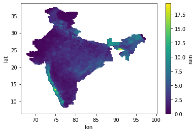

---
# Text of /software/imdlib/. Names, links, version, stats and the citation are in
# src/data/software.yaml.
description: IMDLIB is a Python package to download and process the gridded rainfall and temperature data of the India Meteorological Department (IMD).
---

## Description

IMDLIB is a Python package to download and handle the binary gridded data from the India Meteorological Department (IMD). It covers daily rainfall on a 0.25° grid and daily minimum and maximum temperature on a 1° grid, reads them into [xarray](https://docs.xarray.dev/), and saves them as CSV, NetCDF or GeoTIFF.

## Installation

IMDLIB can be installed with conda, with pip, or from the source on GitHub. It is tested on Windows and Linux (64-bit).

With conda:

```bash
conda install -c conda-forge imdlib
```

With pip:

```bash
pip install imdlib
```

From the source on GitHub:

```bash
pip install git+https://github.com/iamsaswata/imdlib.git
```

## Usage

### Loading data

IMDLIB downloads gridded rainfall and temperature (minimum and maximum) data from [IMD Pune](https://imdpune.gov.in/). One function, `imd.load()`, downloads the files and opens them.

```python
import imdlib as imd

# Daily rainfall for India, 2010 to 2018
data = imd.load('rain', 2010, 2018)   # other options are 'tmin' and 'tmax'

# Or a range of days
data = imd.load('tmax', '2023-04-01', '2023-06-30')
```

The files are kept in a cache folder, so later calls for the same years do not download them again. `load()` returns an *IMD class* object at once and reads the files only when the data is first used.

The main options of `load`:

- `source`: `'archive'` (the default) for the quality-controlled yearly files, or `'realtime'` for the provisional daily files. Real-time data also has GPM rainfall, `'rain_gpm'`.
- `cache_dir`: the cache folder. You can also set it once with `imd.cache.set_dir()` or the `IMDLIB_CACHE` environment variable. Otherwise IMDLIB uses the default cache folder of your user account.
- `offline`: `True` never uses the network, and gives an error that lists any files missing from the cache.
- `parallel`: the number of files downloaded at the same time (default 4).

`get_data` and `open_data` (and `get_real_data` and `open_real_data`) still work, without warnings, so older code keeps running. One change: since 0.3, `clip()` returns the clipped data and no longer changes the object, so write `data = data.clip(...)`. `open_data` is still the way to read `.grd` files that you downloaded yourself into a folder.

### Regions

IMDLIB knows the names of India's 36 states and union territories, 782 districts, 25 CWC river basins, 99 sub-basins and about 548,000 cities, towns and villages. Names are forgiving: case and accents are ignored, and old names such as `'Gurgaon'` work too.

```python
imd.regions.search('pun')                       # find region names
ts = data.region(district=['Pune', 'Nashik'])   # area-weighted mean, one column per district
kerala = data.clip(state='Kerala')              # IMD object for one region
```

`region()` also takes `state`, `city`, `basin`, `subbasin` or a `shapefile`, and `by='district'` gives one column per district of a state.

### Shape of the IMD object

```python
data.shape
```

```text
(365, 135, 129)
```

The dimensions are days, longitudes and latitudes.

### NumPy array

```python
np_array = data.data
```

### xarray object

```python
ds = data.get_xarray()
type(ds)
```

```text
xarray.core.dataset.Dataset
```

### Mean rainfall map

```python
ds['rain'].mean('time').plot()
```



> **Updated September 2026.** `get_xarray()` now masks the missing values (−999) itself, so the earlier `ds.where(ds['rain'] != -999.)` step is no longer needed. The picture is from an earlier version; current versions label the axes and colour bar with names and units.

### Processing and saving

```python
out_dir = '/home/downloads/data'

# Time series at one grid point, saved as CSV
lat = 20.03
lon = 77.23
data.to_csv('rain.csv', lat, lon, out_dir)   # writes rain_20.03_77.23.csv

# Convert to a NetCDF file
data.to_netcdf('rain.nc', out_dir)

# Convert to a GeoTIFF file
data.to_geotiff('rain.tif', out_dir)
```

For GeoTIFF output IMDLIB uses the [rioxarray](https://corteva.github.io/rioxarray/stable/) package, which is not a dependency of IMDLIB. When `to_geotiff()` is called, IMDLIB checks whether rioxarray is installed. If it is, the GeoTIFF file is written. If not, you get an error saying that rioxarray is not installed.

### More functions

> **Updated September 2026.** This section is new. Since the first version of this page, IMDLIB has added:

- real-time daily data (rainfall at 0.25°, temperature at 0.5°): `imd.load(..., source='realtime')`, with dates such as `'2020-01-31'`;
- annual climate indices, for example rainy days, consecutive dry and wet days, heavy rainfall days, maximum 1-day and 5-day rainfall, and the diurnal temperature range, with trend tests (modified Mann-Kendall, Spearman's rho, Sen's slope);
- the drought indices SPI and SPEI;
- heat wave and cold wave days following the IMD criteria: `heatwave()` and `coldwave()`;
- monthly climatology and anomalies: `climatology()` and `anomaly()`;
- clipping to a named region or a shapefile (`clip()`), area-weighted spatial means (`spatial_mean()`, `region()`), filling gaps (`fill_na()`) and regridding (`remap()`).

```python
rain = imd.load('rain', 1991, 2020)

# compute() changes the object in place, so work on a copy
heavy = rain.copy().compute('d64', 'A', threshold=64.5)   # heavy rainfall days per year
spi3 = rain.copy().compute('spi', 'M', timescale=3)       # 3-month SPI
```

The [documentation](https://imdlib.readthedocs.io) lists every index and option.

### NetCDF file convention

IMDLIB writes its final output as netCDF (network Common Data Form), the format most commonly used for climate model data. It follows the netCDF Climate and Forecast (CF) Metadata Conventions, version 1.7, so the files work with other standard netCDF tools. The CRS is `epsg:4326`; `to_geotiff` needs it to work correctly. For more on the CF conventions, see the [CF Conventions home page](https://cfconventions.org) and the [cf_xarray](https://cf-xarray.readthedocs.io/) documentation on using CF with xarray.

```text
test@test:~/data$ ncdump -h test.nc
netcdf test {
dimensions:
	time = 365 ;
	lat = 31 ;
	lon = 31 ;
variables:
	double tmax(time, lat, lon) ;
		tmax:_FillValue = NaN ;
		tmax:units = "C" ;
		tmax:long_name = "Maximum Temperature" ;
	double lat(lat) ;
		lat:_FillValue = NaN ;
		lat:axis = "Y" ;
		lat:standard_name = "latitude" ;
		lat:long_name = "latitude" ;
		lat:units = "degrees_north" ;
	double lon(lon) ;
		lon:_FillValue = NaN ;
		lon:axis = "X" ;
		lon:long_name = "longitude" ;
		lon:units = "degrees_east" ;
	int64 time(time) ;
		time:standard_name = "time" ;
		time:long_name = "time" ;
		time:units = "days since 2010-01-01" ;
		time:calendar = "proleptic_gregorian" ;

// global attributes:
		:Conventions = "CF-1.7" ;
		:title = "IMD gridded data" ;
		:source = "https://imdpune.gov.in/" ;
		:history = "2020-12-29 22:16:07.359709 Python" ;
		:references = "" ;
		:comment = "" ;
		:crs = "epsg:4326" ;
}
```
